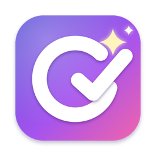
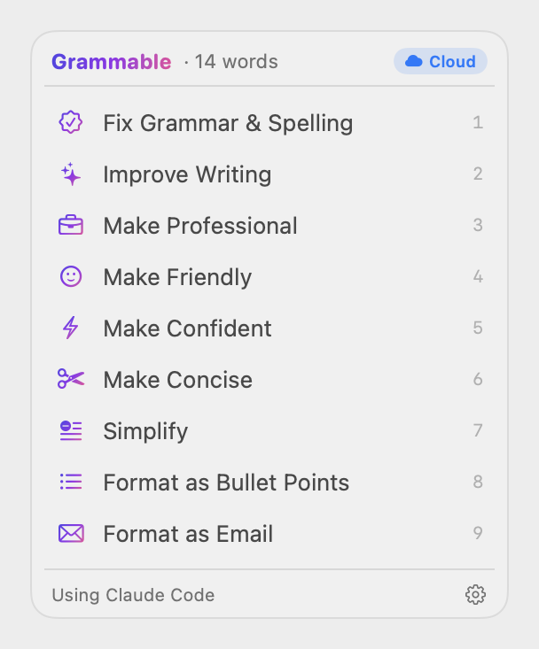
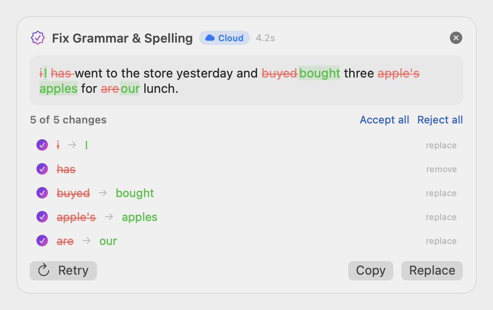
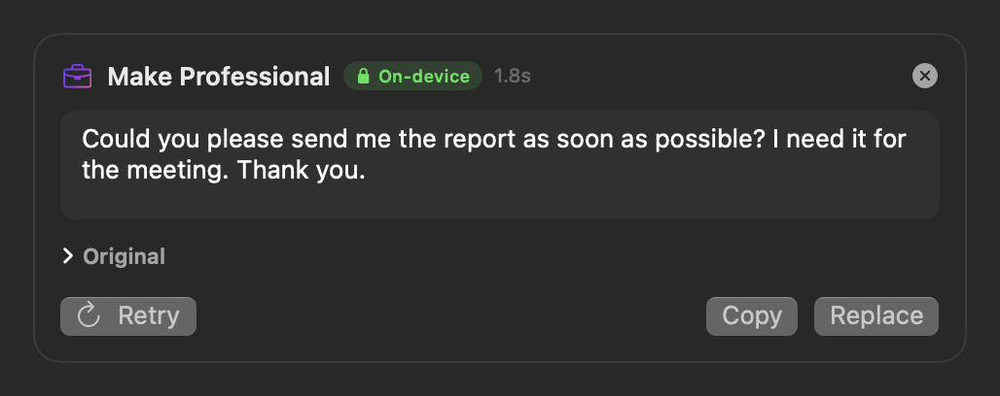
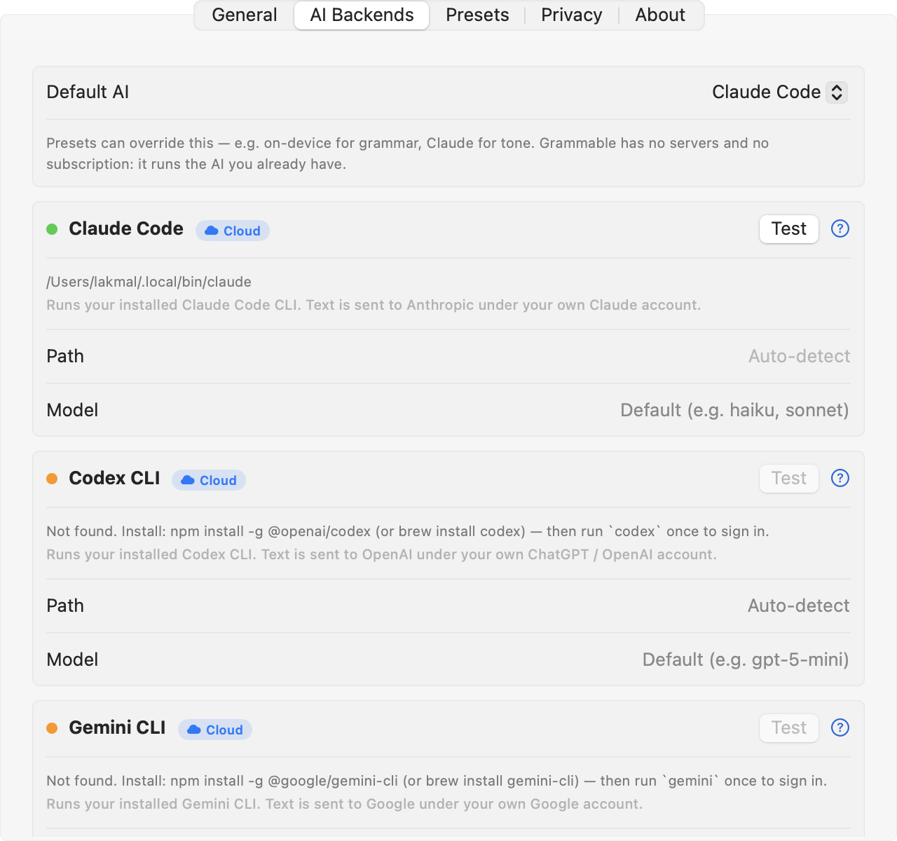

<div align="center">



# Grammable

### Free, open-source AI grammar checker & rewriter for macOS

**Fix grammar and spelling, change tone, rewrite and format text in _any_ Mac app —
powered by the AI you already have: Claude Code, Codex CLI, Gemini CLI, Ollama, LM Studio or Apple Intelligence.**

**No subscription. No account. No servers. 100% free.**

[](LICENSE)
[](#requirements)
[](Package.swift)
[](https://github.com/UdayaLakmal/Grammable/actions/workflows/ci.yml)
[](https://github.com/UdayaLakmal/Grammable/releases)

[**Download**](https://github.com/UdayaLakmal/Grammable/releases/latest) ·
[Features](#features) ·
[How it works](#how-it-works) ·
[AI backends](#supported-ai-backends) ·
[Presets](#custom-presets) ·
[Privacy](#privacy) ·
[FAQ](#faq)

</div>

<p align="center">
  
  
</p>

---

## Why Grammable?

Paying a monthly subscription for a grammar checker when you **already pay for Claude, ChatGPT or Gemini** — or can run a free local model — makes no sense.

Grammable is a tiny **menu bar app** that turns the AI tools already installed on your Mac into a **system-wide writing assistant**, like Grammarly — without the extra subscription, the browser extension or sending your writing to yet another company.

| | Grammable | Typical subscription writing assistants |
|---|---|---|
| Price | **Free forever (GPL-3.0)** | Monthly subscription |
| AI model | **Your choice:** Claude, GPT/Codex, Gemini, Llama, Qwen, Mistral, Apple on-device… | Vendor's model only |
| Offline mode | **Yes** (Ollama, LM Studio, Apple Intelligence) | No |
| Works in | **Any app** with selectable text | Selected apps / browser |
| Extra account | **None** | Required |
| Your own prompts | **Yes** — shareable Markdown presets | Limited |
| Source code | **Open** | Closed |

> **Reuse what you already have.** If Claude Code, Codex or Gemini CLI is signed in on your Mac, Grammable simply runs it — on the plan you already pay for. No API keys to paste, nothing new to buy.

---

## Features

- ✍️ **Grammar & spelling check** for any selected text — mistakes are shown as individual changes you can **accept or reject one by one**.
- 🎭 **Tone adjustment** — Professional, Friendly, Confident, Concise, Simplify.
- 🔁 **Rewrite & improve** — clearer, smoother writing with an editable before/after view.
- 📋 **Format text** — bullet points, email format, or anything you define.
- 🖱️ **Appears when you select text** — a small **G** button pops up next to your selection; click it for actions. No live typing surveillance.
- ⌨️ **Global shortcut `⌃⌥G`** — works even when the pop-up button is turned off.
- 🧠 **Choose the AI per action** — e.g. on-device Ollama for grammar, Claude for tone.
- 🔒 **Privacy badge on every result** — always shows whether your text stayed **On-device** or went to the **Cloud**.
- 📝 **Custom presets as Markdown files** — write your own house style, share it on GitHub.
- 🟢 **Menu bar on/off switch** — pause Grammable instantly.
- 🚫 **Per-app exclusions** — never pops up in Terminal, password managers, or apps you choose.
- 🔑 **Never reads password fields.** Your clipboard is restored after every action.
- 🪶 **Native & lightweight** — Swift + SwiftUI, universal binary (Apple silicon & Intel), no Electron.
- 🧰 **Command-line mode** — `Grammable --run fix-grammar "text"` for scripts and Shortcuts.

## How it works

```
 Select text in any app ──► G button appears ──► pick an action ──► review ──► Replace / Copy
        (Mail, Slack, Notes, Safari, Chrome, Word, VS Code, …)         │
                                                                       ▼
                     Claude Code · Codex CLI · Gemini CLI · Ollama · LM Studio · Apple Intelligence
```

1. **Select** some text you wrote — in any app.
2. Click the **G** button that appears next to it (or press **`⌃⌥G`**).
3. Choose an action: **Fix Grammar & Spelling**, **Make Professional**, **Make Concise**, **Format as Email**… (number keys `1`–`9` work too).
4. **Review** the suggestion:
   - *Grammar fixes* → every change is listed; tick the ones you want.
   - *Rewrites* → an editable before/after view.
5. Press **Replace** (`↩`) to put the text back in place, or **Copy**.

<p align="center">
  
</p>

## Supported AI backends

Grammable never bundles a model or calls its own server. It drives tools **you already have installed**:

| Backend | Where your text goes | What you need | Cost |
|---|---|---|---|
| **[Claude Code](https://docs.anthropic.com/en/docs/claude-code)** | ☁️ Anthropic, under **your own** Claude account | `claude` CLI installed & signed in | Included in your Claude plan |
| **[Codex CLI](https://github.com/openai/codex)** | ☁️ OpenAI, under **your own** ChatGPT / OpenAI account | `codex` CLI installed & signed in | Included in your ChatGPT plan |
| **[Gemini CLI](https://github.com/google-gemini/gemini-cli)** | ☁️ Google, under **your own** Google account | `gemini` CLI installed & signed in | Free tier available |
| **[Ollama](https://ollama.com)** | 🔒 **Stays on your Mac** | Ollama running + any model (`ollama pull llama3.2`) | Free |
| **[LM Studio](https://lmstudio.ai)** / Jan / llama.cpp | 🔒 **Stays on your Mac** | Local OpenAI-compatible server | Free |
| **Apple Intelligence** | 🔒 **Stays on your Mac** | macOS 26+, Apple silicon, Apple Intelligence on, built with Xcode 26+ | Free |

> ⚠️ **Important — about "local".** Grammable itself runs entirely on your Mac and has no servers. However, **Claude Code, Codex CLI and Gemini CLI are cloud services**: when you choose them, your selected text is sent to Anthropic, OpenAI or Google using **your own** installed and signed-in CLI, under your account and their terms. For **fully offline** use, choose **Ollama**, **LM Studio** or **Apple Intelligence**. Every result shows an **On-device** or **Cloud** badge so you always know.

<p align="center"></p>

Grammable finds the CLIs automatically (Homebrew, npm, bun, volta, nvm, `~/.local/bin`…). You can also set a custom path and model for each backend in **Settings → AI Backends**, and test it with one click.

## Installation

### Download (recommended)

1. Download the latest **`Grammable-x.y.z.zip`** from [**Releases**](https://github.com/UdayaLakmal/Grammable/releases/latest).
2. Unzip and drag **Grammable.app** to **Applications**.
3. Open it. If macOS says it can't verify the developer, **right-click → Open** once, or run:
   ```bash
   xattr -dr com.apple.quarantine /Applications/Grammable.app
   ```
4. Allow **Accessibility** when asked (System Settings → Privacy & Security → Accessibility). This lets Grammable read your selection and paste the result back.
5. Look for the **G** icon in the menu bar. Done!

### Build from source

Requires Xcode 15+ (Xcode 26+ to include Apple Intelligence support).

```bash
git clone https://github.com/UdayaLakmal/Grammable.git
cd Grammable
./scripts/build-app.sh          # creates dist/Grammable.app (universal)
open dist/Grammable.app
```

Run the tests with `swift test`.

### Set up at least one AI backend

```bash
# Option A — reuse a subscription you already have (cloud)
npm install -g @anthropic-ai/claude-code && claude      # sign in once
npm install -g @openai/codex && codex                   # sign in once
npm install -g @google/gemini-cli && gemini             # sign in once

# Option B — 100% offline and free
brew install ollama && ollama serve &
ollama pull llama3.2
```

## Custom presets

Every action is a plain **Markdown file** in `~/.grammable/presets/`. Create one in **Settings → Presets → Create**, or by hand:

```markdown
---
name: Professional Email
icon: briefcase        # any SF Symbol name
mode: rewrite          # rewrite = before/after view · fix = accept/reject each change
backend: claude        # optional: claude | codex | gemini | ollama | openai-compatible | apple
model: haiku           # optional, backend-specific
order: 15              # optional, position in the menu
---
Rewrite the text as a clear, polite, professional email.
Keep it short. Do not invent facts.
```

- A file with the same name as a built-in preset (e.g. `fix-grammar.md`) **replaces** it — click **Customize** in Settings to start from the built-in.
- Use `backend:` to **mix AIs per action**: free local Ollama for quick grammar fixes, Claude for nuanced tone.
- Browse and share community presets in the [`presets/`](presets) folder — pull requests welcome!

**Built-in presets:** Fix Grammar & Spelling · Improve Writing · Make Professional · Make Friendly · Make Confident · Make Concise · Simplify · Format as Bullet Points · Format as Email

## Command line

The app binary doubles as a CLI — useful for scripts, Automator and Shortcuts:

```bash
G=/Applications/Grammable.app/Contents/MacOS/Grammable
$G --status                                    # which backends are available
$G --list                                      # list presets
$G --render-ui ~/Desktop/grammable-ui          # render every screen to PNG
$G --run fix-grammar --diff "i has went home"  # → I went home.
pbpaste | $G --run professional --backend ollama | pbcopy
```

## Privacy

- **No servers, no telemetry, no analytics, no account.** Grammable never phones home.
- Selected text is read **locally** to decide whether to show the button. It is sent to an AI **only when you choose an action**, and **only** to the backend you picked.
- **Password fields are never read.** Terminals and password managers are excluded by default.
- Your **clipboard is restored** after copy/paste fallbacks, and temporary entries are marked so clipboard managers ignore them.
- CLIs run in an empty temporary folder with tools, MCP servers and project settings **disabled** (Claude Code runs with `--tools "" --strict-mcp-config --setting-sources ""`), so the AI only ever sees the text you selected.
- Nothing you write is logged or stored.

## Requirements

- macOS 13 Ventura or later (Apple silicon or Intel)
- Accessibility permission
- At least one AI backend from the table above

## FAQ

<details>
<summary><b>Is Grammable really free? What's the catch?</b></summary>

Yes — it's GPL-3.0 open source. There's no paid tier, no account and no server costs, because the AI runs through tools you already have. If it saves you a subscription, consider [sponsoring the project](https://github.com/sponsors/UdayaLakmal) ❤️.
</details>

<details>
<summary><b>Is this a free Grammarly alternative for Mac?</b></summary>

Grammable covers the most-used parts — grammar & spelling fixes, tone changes, rewriting and formatting in any app — using an AI of your choice. It intentionally does **not** do live as-you-type underlining; it works on text you select.
</details>

<details>
<summary><b>Does it work offline?</b></summary>

Yes, with **Ollama**, **LM Studio** (or any local OpenAI-compatible server) or **Apple Intelligence**. Claude Code, Codex and Gemini CLI need the internet.
</details>

<details>
<summary><b>Do I need an API key?</b></summary>

No. Grammable uses the CLIs you have already signed in to (Claude Code, Codex, Gemini), or local models that need no key at all.
</details>

<details>
<summary><b>Which apps does it work in?</b></summary>

Any app where you can select text: Mail, Notes, Messages, Pages, Safari, Chrome, Slack, Discord, Notion, Microsoft Word & Outlook, VS Code and more. For apps that don't expose text through Accessibility, Grammable falls back to copy/paste automatically (use `⌃⌥G`).
</details>

<details>
<summary><b>Why isn't it on the Mac App Store?</b></summary>

The App Store sandbox forbids running other command-line tools and the Accessibility features Grammable needs. It is distributed through GitHub instead.
</details>

<details>
<summary><b>The G button doesn't appear.</b></summary>

Check that Grammable is **Enabled** in the menu bar, Accessibility is granted (Settings → General), and the app isn't in the exclusion list (Settings → Privacy). After updating an unsigned build, macOS may require you to remove and re-add Grammable in the Accessibility list. You can always use `⌃⌥G`.
</details>

<details>
<summary><b>Which backend is fastest?</b></summary>

Local models on Apple silicon (Ollama with a small model such as `llama3.2` or `qwen2.5:3b`) usually answer in 1–3 seconds. Agent CLIs typically take 3–8 seconds. Set a smaller model (e.g. `haiku` for Claude) in Settings for faster replies.
</details>

## Roadmap

- [ ] Customizable keyboard shortcut
- [ ] Homebrew cask (`brew install --cask grammable`)
- [ ] Signed & notarized releases
- [ ] Preset chaining (e.g. Fix Grammar → Make Concise)
- [ ] Explanations for each grammar fix
- [ ] Localization

## Contributing

Bug reports, presets and pull requests are very welcome — see [CONTRIBUTING.md](CONTRIBUTING.md). The easiest way to contribute is to **share a useful preset** in [`presets/`](presets).

## Support

Grammable is free and always will be. If it's useful to you:

- ⭐ **Star this repo** — it helps others find it
- ❤️ [**Sponsor on GitHub**](https://github.com/sponsors/UdayaLakmal)
- 🐛 [Report bugs & request features](https://github.com/UdayaLakmal/Grammable/issues)

## License

Copyright © 2026 Udaya Lakmal.

Grammable is free software: you can redistribute it and/or modify it under the terms of the [GNU General Public License v3.0](LICENSE) or (at your option) any later version.

Claude, Codex, Gemini, Ollama, LM Studio, Apple Intelligence and Grammarly are trademarks of their respective owners. Grammable is an independent project and is not affiliated with or endorsed by any of them.

---

<sub>Keywords: free grammar checker for Mac, AI writing assistant macOS, Grammarly alternative, open source grammar checker, rewrite text with AI, tone changer, paraphrasing tool, spell checker, proofreading app, Claude Code, Codex CLI, Gemini CLI, Ollama, LM Studio, local LLM, offline AI writing, Apple Intelligence Writing Tools alternative, menu bar app, SwiftUI.</sub>
